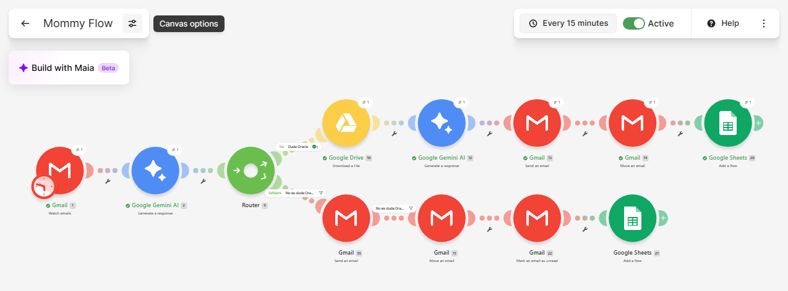

# Mommy Flow - Automatización Inteligente de Atención al Cliente (Oracle & Help Desk)

## 📌 Descripción del Proyecto

Mommy Flow es un escenario de automatización desarrollado en Make diseñado para optimizar el triaje y la respuesta de correos electrónicos entrantes en Gmail. El sistema implementa un enrutamiento condicional avanzado para clasificar las consultas en dos canales operativos principales:

1. Ruta Oracle (Automatizada con IA): Procesa consultas específicas utilizando el modelo Gemini 3.5 Flash Lite integrado con RAG (Retrieval-Augmented Generation) a partir de archivos de documentación almacenados en Google Drive, generando respuestas automáticas precisas e inmediatas.
2. Ruta Help Desk (Soporte Humano): Deriva las consultas técnicas o generales hacia el equipo de soporte humano, enviando un correo de cortesía al usuario (con aviso de respuesta en 72 hs hábiles), organizando el mensaje en la etiqueta correspondiente de Gmail, marcándolo como no leído para asegurar su atención prioritaria y centralizando el seguimiento.

Ambas rutas quedan registradas en tiempo real en una única planilla de Google Sheets para asegurar trazabilidad y auditoría completa de los mensajes.

---

## 📸 Arquitectura del Escenario



---

```text
┌─────────────────────────────────────────────────────────────────────────────────────────┐
│                                 [📩 Gmail: Watch Emails]                                │
└───────────────────────────────────────────┬─────────────────────────────────────────────┘
                                            │
                                            ▼
                                [🔀 Router: Clasificación]
                                            │
                 ┌──────────────────────────┴──────────────────────────┐
                 │                                                     │
                 ▼ (Duda Oracle)                                       ▼ (Help Desk)
  ┌──────────────────────────────┐                      ┌──────────────────────────────┐
  │ 📄 Google Drive (RAG Doc)    │                      │ ✉️ Gmail (Mail Cortesía 72h) │
  └──────────────┬───────────────┘                      └──────────────┬───────────────┘
                 │                                                     │
                 ▼                                                     ▼
  ┌──────────────────────────────┐                      ┌──────────────────────────────┐
  │ 🤖 Gemini 3.5 Flash Lite     │                      │ 📂 Gmail (Mover a Folder)    │
  └──────────────┬───────────────┘                      └──────────────┬───────────────┘
                 │                                                     │
                 ▼                                                     ▼
  ┌──────────────────────────────┐                      ┌──────────────────────────────┐
  │ ✉️ Gmail (Enviar Respuesta)  │                      │ 📌 Gmail (Mark as Unread)    │
  └──────────────┬───────────────┘                      └──────────────┬───────────────┘
                 │                                                     │
                 └──────────────────────────┬──────────────────────────┘
                                            │
                                            ▼
                                ┌────────────────────────┐
                                │ 📊 Google Sheets (Log) │
                                └────────────────────────┘

```
----
### 1. Desencadenante (Trigger)
* Gmail - Watch Emails: Revisa periódicamente (cada 15 minutos) la casilla de correo en busca de mensajes no leídos.

### 2. Enrutamiento Condicional
Un Router evalúa el contenido y asunto del correo entrante:
* Filtro "Duda Oracle": Redirige a la rama superior si la consulta refiere a módulos o documentación de Oracle.
* Filtro "Help Desk": Redirige a la rama inferior cuando la consulta no corresponde a la temática de Oracle.

### 3. Ejecución por Ruta

#### Ruta Superior (Oracle AI):
1. Google Drive: Recupera el documento técnico de soporte (convertido a formato Google Docs para evitar interferencias de compatibilidad).
2. Google Gemini AI: Procesa la consulta junto al contexto recuperado mediante el modelo Gemini 3.5 Flash Lite, garantizando alta velocidad de respuesta y evitando timeouts.
3. Gmail - Send an Email: Envía la respuesta redactada por la IA directamente al usuario.
4. Google Sheets - Add a Row: Registra la fecha, remitente, asunto, clasificación (Duda Oracle) y el texto de la respuesta enviada.

#### Ruta Inferior (Help Desk Human):
1. Gmail - Send an Email: Envía un correo automático de cortesía informando la recepción y derivación de la consulta (plazo de respuesta 72 hs hábiles).
2. Gmail - Move an Email: Mueve el correo entrante a la carpeta/etiqueta Help Desk Human.
3. Gmail - Mark as Unread: Marca el correo como no leído para que el operador humano identifique el trabajo pendiente en su bandeja de entrada.
4. Google Sheets - Add a Row: Registra la fecha, remitente, asunto, clasificación (Desk Help Human) y la confirmación de envío en la misma planilla de control.

---

## ⚙️ Desafíos Técnicos Resueltos

* Optimización de Modelos IA: Se seleccionó Gemini 3.5 Flash Lite para mitigar la latencia y evitar fallos por timeout provocados por la alta demanda en modelos estándar.
* Compatibilidad de Formatos en RAG: Se convirtieron archivos .md de origen a Google Docs para garantizar la correcta extracción de texto en los nodos de Google Drive.
* Secuencia de Estado de Lectura: Se estructuró el flujo para asegurar que el marcado de correo como Unread se aplique posterior al movimiento de carpeta y previo al registro final en Sheets.
* Consolidación de Datos: Se unificó el registro de ambas rutas en una sola planilla de Google Sheets, manteniendo diferenciadas las tipologías de respuesta mediante etiquetas fijas y dinámicas.
---

## 🔗 Escenario Interactivo en Make

Podés explorar el escenario completo directamente desde Make en el siguiente enlace:

👉 **[Ver Escenario Público en Make](https://us2.make.com/public/shared-scenario/kD0QLxNyg7E/mommy-flow)**

## 👤 Desarrollado por

Noelia Natalia María Orsini  
Abogada (UBA - Esp. Derecho Empresarial) | Counselor / Consultora Psicológica | Desarrolladora Back-End | Analista de Datos | Especialista en QA Automation & Agentes IA

📍 Ubicación: Lobos, Buenos Aires, Argentina  

### 🔗 Enlaces Profesionales
* 💼 **LinkedIn:** [linkedin.com/in/noelia-orsini](https://www.linkedin.com/in/noelia-orsini)
* 🐙 **GitHub:** [github.com/NoeliaOrsini](https://github.com/NoeliaOrsini)
* 🌐 **Portafolio:** [noelia-orsini-portafolio.lovable.app](https://noelia-orsini-portafolio.lovable.app/)
